cs creates persistent workspaces for [Claude Code](https://github.com/anthropics/claude-code), with session notes, conversation resume, and local git history.

[](https://github.com/hex/claude-sessions/actions/workflows/test.yml)

## Install

Requires macOS or Linux, Bash 3.2+, git, jq, perl, Claude Code, and a UTF-8 locale.
Remote control needs Claude Code 2.1.299+.
Non-UTF-8 locales such as `ja_JP.eucJP`, `ko_KR.eucKR`, and `zh_CN.eucCN` cause syntax errors in cs and two of its hooks.

```bash
curl -fsSL https://github.com/hex/claude-sessions/releases/latest/download/install.sh | bash
```

From a checkout:

```bash
git clone https://github.com/hex/claude-sessions.git
cd claude-sessions
./install.sh
```

Review [install.sh](install.sh) before running it. The piped command always installs the release, even inside a checkout.
The installer puts the commands in `~/.local/bin/`, registers hooks, and installs skills, mods, and Bash and Zsh completions.
When `~/.claude/settings.json` names no spinner tips file, the installer names cs's there as `spinnerTipsOverride.tipsFile` ([spinner tip](docs/configuration.md#spinner-tip)).
Updates and prebuilt picker downloads require `ssh-keygen` with `-Y verify` support to check the [signed release manifest](docs/configuration.md#release-verification-and-notes).

## Usage

```bash
cs debug-api
```

One command, from any terminal: `cs <name>` creates the session the first time and resumes it every time after. It needs no project or git repository first.

## First run in 60 seconds

1. Run `cs debug-api`. cs creates a workspace and opens Claude Code.
2. Describe your task. cs records the first substantive prompt in the session's `Objective` section and keeps notes under `.cs/`.
3. Exit Claude Code. Run `cs debug-api` again and accept the prompt to resume the recorded conversation.

When you forget a name, a bare `cs` opens a picker of your sessions, and `cs .` reopens the one whose root you are in.


The [statusline guide](docs/statusline.md) covers the quiet default layout, the band and the capsules, colors, thresholds, font setup, and agent rows.

## Features

| Feature | What it does | Details |
|---|---|---|
| Session records | Keeps objectives, per-actor narratives, memory, plans, checkpoints, and a timeline in `.cs/`. | [Session layout](docs/session-layout.md) |
| Crash recovery | Saves edits to shadow git refs without adding normal branch commits. | [Autosave hook](docs/hooks.md#autosave-commitssh-posttooluse-on-writeedit) |
| Conversation rotation | Hands work to a fresh conversation through `/rotate` and `/clear`. | [Rotation and queue hooks](docs/hooks.md#narrative-remindersh-stop-filechanged-cwdchanged) |
| Existing projects | `cs -adopt <name>` registers your project without moving it. | [Adoption](docs/commands.md#adopt-an-existing-project) |
| Parallel worktrees | `cs <base>@<feature>` gives each feature its own checkout and session records. | [Worktrees](docs/commands.md#parallel-worktrees) |
| Remote control | `cs <name> --remote` serves a session for the Claude app or web. | [Remote control](docs/commands.md#remote-control) |
| Task queue | Runs confirmed tasks at turn boundaries, with failure, context, and quota breakers. | [Queue behavior](docs/hooks.md#narrative-remindersh-stop-filechanged-cwdchanged) |
| Cross-session mail | Delivers local messages and wakes idle sessions for unread arrivals. | [Mail wakes](docs/hooks.md#narrative-remindersh-stop-filechanged-cwdchanged) |
| Secrets | Uses the macOS keychain or encrypted files, with signed age exports for sync. | [Secrets guide](docs/secrets.md) |
| Encrypted sessions | Keeps notes, transcripts, plans, and private state in a vault on macOS. | [Encrypted sessions](docs/session-layout.md#encrypted-sessions) |
| Statusline | Shows session, git, model, context, queue, mail, and rate limits. | [Statusline guide](docs/statusline.md) |
| Prompt rail | With `cs.bandPrompts` on in `/config`, the band above the prompt draws a bar per prompt. A press on a bar, or `/cs next`, `prev`, `first`, `last` or a prompt number, scrolls the transcript to that prompt. | [cs mod band](docs/hooks.md#cs-not-a-hook-script--a-claude-code-mod) |
| Prompt grounding | Adds matching files, recent commits, changes, and clarification guidance to code-work prompts. | [Scope hook](docs/hooks.md#scope-promptsh-userpromptsubmit) |
| Prompt rewriting | Ctrl+G rewrites a draft in the composer for you to review before sending. | [Prompt rewriter](docs/hooks.md#prompt-rewritersh-not-a-hook--an-editor-shim) |
| Writing skills | Judges prose or drafts from a writing profile. | [Skills](docs/hooks.md#skills) |
| Session wrap | `/wrap` saves memory, summarizes the narrative, and archives completed tasks without committing. Its memory pass also finds references to paths, `cs` verbs and identifiers that no longer exist, and updates them or marks them gone. | [Memory checks](docs/hooks.md#memory-index-guardsh-not-a-hook--run-by-wraps-memory-pass) |
| Inline Mermaid | Draws supported flowcharts in replies, and a `show-me` skill answers "show me" with one. | [Mermaid mod](docs/hooks.md#cs-mermaid-not-a-hook-script--a-claude-code-mod)<br> |
| Release notes | A launch from your terminal offers a pending release once. In the session, `/cs-update` shows its release notes. | [Update mod](docs/hooks.md#cs-update-not-a-hook-script--a-claude-code-mod) |
| Settings | `cs -config set <KEY> <value>` keeps a cs setting in `~/.config/cs/config`, or in one session's own file, where every cs command, hook and status line repaint reads it. | [Settings file](docs/configuration.md#settings-file) |
| Settings pane | `/cs` opens a pane of cs's settings, its mods' `/config` rows and its own `CS_*` settings, and changes one with a key: on this machine, or for this session only. | [Panel mod](docs/hooks.md#cs-panel-not-a-hook-script--a-claude-code-mod) |
| Other front ends | Session hooks also work in desktop and IDE conversations opened in a `.cs/` workspace. | [Session resolution](docs/hooks.md#how-a-hook-finds-its-session-cs-resolvesh) |

## Uninstall

```bash
cs -uninstall
```

## Documentation

| Guide | Contents |
|---|---|
| [Commands](docs/commands.md) | Command reference, adoption, worktrees, queues, remote control, and completion. |
| [Configuration](docs/configuration.md) | Every environment variable cs reads, the settings file that keeps them, and the values cs exports. |
| [Session layout](docs/session-layout.md) | Shared and local records, encryption, and merge policy. |
| [Hooks](docs/hooks.md) | Hook behavior, prompt rewriting, and Claude Code mods. |
| [Secrets](docs/secrets.md) | Storage backends, backups, and signed sync files. |
| [Statusline](docs/statusline.md) | Segments, the quiet, band and capsule layouts, colors, thresholds, and agent rows. |

## License

[MIT](LICENSE). Contributions can start with an issue or pull request.
